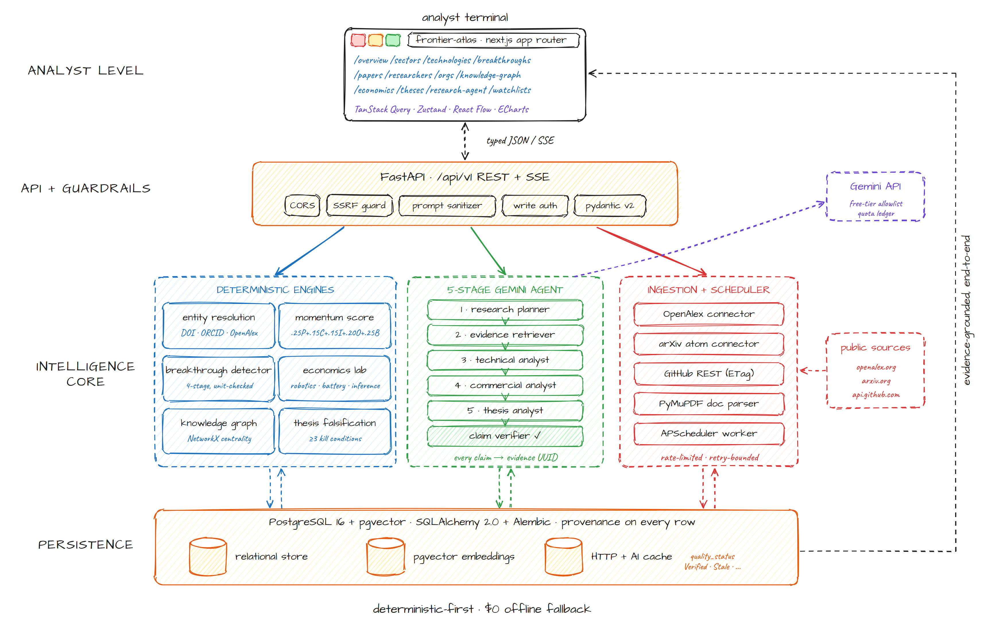

# Frontier Atlas

**Discover the technological inflection points that create tomorrow's companies.**

Frontier Atlas is an open-source, institutional-grade deep-tech research and investment intelligence platform built for venture capital analysts, partners, technical researchers, and founders. It combines real scientific ingestion (OpenAlex, arXiv, GitHub), deterministic technology momentum & breakthrough scoring, first-principles unit economics modeling (Robotics, Battery Storage, AI Inference), a NetworkX-backed Knowledge Graph, and a controlled 5-stage Google Gemini research agent pipeline.



---

## Core Capabilities

1. **10 Frontier Technology Verticals** (Deep coverage on Robotics & Autonomous Systems, AI Infrastructure, and Energy Storage & Battery Technologies; full vertical support across Semiconductors, Biotechnology, Aerospace, Climate/Industrial, Advanced Materials, Quantum Computing, and Nuclear/Fusion).
2. **Real Public Research & Open-Source Ingestion**:
   - **OpenAlex REST Connector**: Publications, citations, authors, institutions, and topic taxonomy with cursor pagination and polite-pool rate limiting.
   - **arXiv Atom Connector**: Preprint metadata, categories, canonical IDs, and OpenAlex reconciliation with 3-second request pacing.
   - **GitHub REST Connector**: Repository metadata, contributors, releases, and dated `repository_snapshots` with ETag conditional fetching.
3. **Identifier-First Entity Resolution**: Reconciles papers (DOI $\rightarrow$ arXiv $\rightarrow$ OpenAlex $\rightarrow$ normalized title), researchers (ORCID $\rightarrow$ OpenAlex Author ID), and organizations/companies with reversible merge history.
4. **Deterministic Technology Intelligence & Breakthrough Detector**:
   - Explainable **Momentum Score** ($0.25P + 0.15C + 0.15I + 0.20O + 0.25B$) with missing-data coverage thresholds and SciPy change-point / anomaly detection.
   - 4-Stage **Breakthrough Detector** verifying unit and test-condition comparability against historical baselines before computing percentage improvements.
5. **Technology Economics Lab**:
   - Deterministic Python models for **Robotics**, **Battery Lifecycle Cost**, and **AI Inference Unit Economics** with Base/Bull/Bear/Custom scenarios, 1-way Tornado sensitivity charts, 2D sensitivity heatmaps, and break-even curves.
6. **Controlled 5-Stage Gemini Research Agent**:
   - Uses only the official `google-genai` SDK reading `GEMINI_MODEL` from environment variables, validated against a free-tier eligibility allowlist with strict daily/per-run budgets and deterministic fallback when offline.
7. **22-Section Investment Thesis Studio & Falsification Engine**:
   - Every thesis tracks $\ge 3$ quantitative falsification conditions, verified source citations, revision history, and local Markdown/PDF export via PyMuPDF.

---

## Quickstart

### Option A: Docker Compose
```bash
git clone <repository-url>
cd frontier-atlas
cp .env.example .env
docker compose up --build
```

### Option B: Local Bare-Metal Development (PostgreSQL + uv + Node.js)
```bash
cp .env.example .env

# 1. Backend setup, migrations & fixture/case-study seeding
cd services/api
uv sync --all-extras
uv run alembic upgrade head
uv run python -m app.db.seed
uv run uvicorn app.main:app --host 0.0.0.0 --port 8000 --reload

# 2. Frontend setup & dev server
cd ../../apps/web
npm install
npm run dev
```

Open `http://localhost:3000` for the Frontier Atlas terminal and `http://localhost:8000/docs` for the OpenAPI specification.
