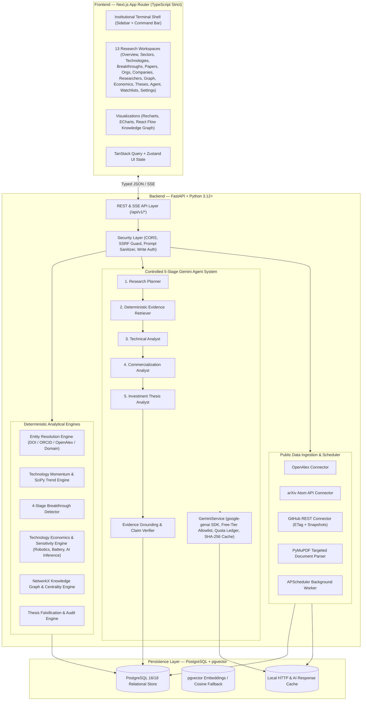

# Frontier Atlas — System Architecture

## 1. High-Level System Topology

---

## 2. Layered Backend Architecture (`services/api`)

No FastAPI route handler directly executes complex SQL queries or business formulas. Every request traverses strict architectural layers:

1. **API Routers (`app/api/v1/`)**: Input validation via Pydantic v2 schemas, pagination parameters, SSE streaming response wrappers, and consistent HTTP error envelopes.
2. **Domain Services & Analytical Engines (`app/intelligence/`, `app/scoring/`, `app/economics/`, `app/agents/`, `app/reports/`, `app/ingestion/`)**: Pure business logic, deterministic mathematical models, NetworkX algorithms, and orchestrated research workflows.
3. **Repositories (`app/repositories/`)**: Encapsulated SQLAlchemy 2.0 queries, eager loading, deduplicated upserts, and audit trail logging.
4. **Models & Migrations (`app/models/`, `alembic/`)**: Normalized relational schema with explicit foreign keys, composite unique constraints, UTC timestamps, and provenance columns.
5. **External Connectors (`app/integrations/`)**: Rate-limited, retry-bounded HTTP clients (`httpx`) for OpenAlex, arXiv, GitHub, and `google-genai` that validate raw payloads into intermediate DTOs before passing to ingestion services.

---

## 3. Relational Data Model & Provenance Guarantees

Every core research entity tracks:
- `id`: Stable internal UUIDv4 primary key.
- External identifiers (e.g., `doi`, `openalex_id`, `arxiv_id`, `orcid`, `github_repository_id`) with unique indexes.
- `data_source`: Origin connector or fixture identifier.
- `quality_status`: Enum (`Verified`, `Source-backed`, `Unverified`, `Conflicting`, `Stale`, `Unavailable`).
- `created_at`, `updated_at`, `last_verified_at`: Timezone-aware UTC timestamps.

### Strict Financial & Metric Integrity Rules
- **`companies`**: `funding_amount` and `funding_stage` require `funding_amount_source_id` / `funding_stage_source_id`. AI agents are structurally prohibited from writing to company funding fields. Unverified private financials remain `NULL` and display **"Insufficient publicly verified data."**
- **`technology_metrics`**: Database constraints and Pydantic validators reject any metric missing `unit` or `source_id`.
- **`repository_snapshots`**: GitHub star/fork growth (`7d`, `30d`, `90d`) is computed strictly from dated rows in `repository_snapshots` (`UNIQUE(repository_id, snapshot_date)`). If prior snapshots do not span the window, growth returns `None` (`Insufficient snapshot history`) rather than extrapolating backward from today's total.

---

## 4. Deterministic Mathematical & Statistical Engines

### 4.1 Technology Momentum Score (`v1.0.0`)
$$\text{Momentum} = 0.25 P + 0.15 C + 0.15 I + 0.20 O + 0.25 B$$
- $P$: Publication acceleration percentile rank (0–100)
- $C$: Age-adjusted citation momentum percentile rank (0–100)
- $I$: Research institution expansion percentile rank (0–100)
- $O$: Open-source repository activity & contributor velocity percentile rank (0–100)
- $B$: Verified technical benchmark progress percentile rank (0–100)
- **Missing Component Handling**: Never substitutes `0` for missing data. Re-weights available components proportionally, reports `coverage_ratio` ($\in [0, 1]$) and `missing_components`, and suppresses the composite score (`score = None`, `status = "insufficient_coverage"`) if weighted coverage $< 0.50$.

### 4.2 Breakthrough Candidate Score (`v1.0.0`)
$$\text{Breakthrough Score} = 0.30 T_{\text{imp}} + 0.20 N + 0.20 R + 0.20 E_{\text{econ}} + 0.10 Q_{\text{ev}}$$
- Requires unit equality (`baseline_unit == candidate_unit`) and comparable test conditions before calculating percentage improvement.
- Reproducibility ($R$) is evaluated from independent lab replication, open-source code release, and benchmark standardization—never inferred solely from citation count.

### 4.3 Technology Economics Engine
Implemented as pure, unit-tested deterministic Python functions in `app/economics/models.py`:
1. **Robotics Model**: Annualized CapEx (with discount rate / straight-line amortization), annual OpEx (maintenance + energy + supervision), effective annual successful tasks, cost per successful task vs. human labor baseline, break-even utilization rate, and task-success elasticity.
2. **Battery Lifecycle Cost Model**: Total pack capital cost ($\$/\text{kWh} \times \text{capacity}$), lifetime delivered energy across cycle life, depth of discharge (DoD), degradation factor, and round-trip efficiency ($\eta_{\text{RTE}}$), yielding approximate levelized cost per delivered kWh ($\$/\text{kWh}_{\text{delivered}}$).
3. **AI Inference Unit Economics Model**: Accelerator CapEx amortization over useful life, facility power cost ($\text{TDP} \times \text{PUE} \times \text{electricity rate}$), serving/networking overhead, effective annual tokens generated at specified utilization and throughput, and cost per 1M tokens.

---

## 5. Controlled Gemini Research Agent Architecture

The AI layer uses only the official `google-genai` SDK (`from google import genai`):
- **Model Selection**: Reads `GEMINI_MODEL` from environment (defaulting to `gemini-3.8-flash` with fallback discovery across free-tier eligible Flash models). Rejects any paid/pro model not on the free-tier allowlist.
- **Quota & Cost Guardrails**: Every call checks per-minute token buckets, `AI_MAX_REQUESTS_PER_DAY`, and `AI_MAX_REQUESTS_PER_RUN` against the `ai_requests` table before dispatching.
- **Deterministic Fallback**: When `ENABLE_AI=false`, `GEMINI_API_KEY` is unset, or free-tier quota is reached, the 5-stage pipeline executes deterministic evidence synthesis over the local PostgreSQL database so all workflows remain functional at $0 cost.
- **Evidence Grounding Enforcement**: Every generated claim must reference valid UUIDs in `evidence_sources`. The `ClaimVerifier` checks database existence and numeric appearance in source excerpts, stripping or flagging any ungrounded claim.
